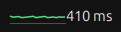

# watch-ping

GNOME Shell extension that displays network latency in the top bar.

## Description

This extension periodically pings a configured host and updates the label with
the latest response time in milliseconds. Host and interval can be changed in
the extension preferences.



## Building and Testing

```bash
./scripts/build-extension.sh
gnome-extensions install ./dist/watch-ping@example.com.v1.shell-extension.zip
```

You can test the extension without logging out via a nested shell.

```bash
./scripts/build-extension.sh
gnome-extensions install --force ./dist/watch-ping@example.com.v1.shell-extension.zip
dbus-run-session gnome-shell --devkit --wayland
```
